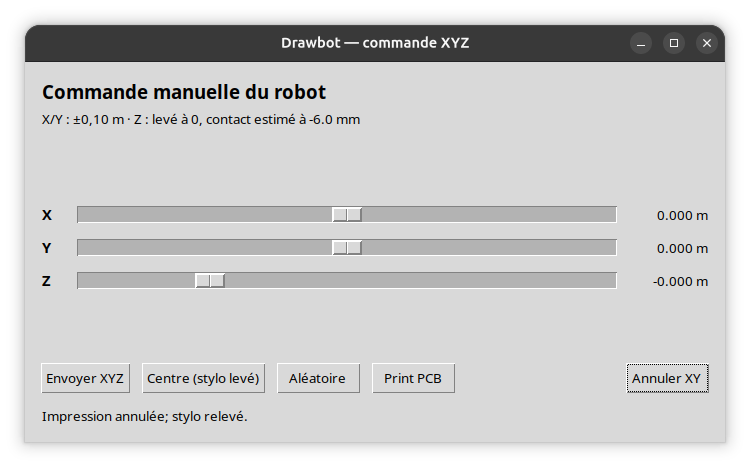
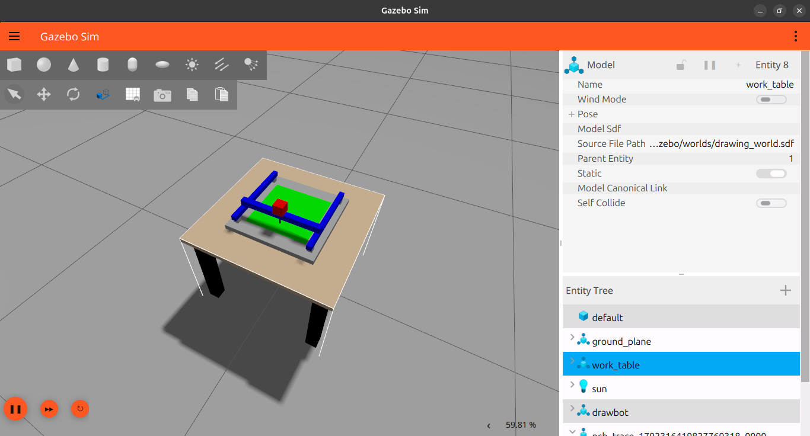
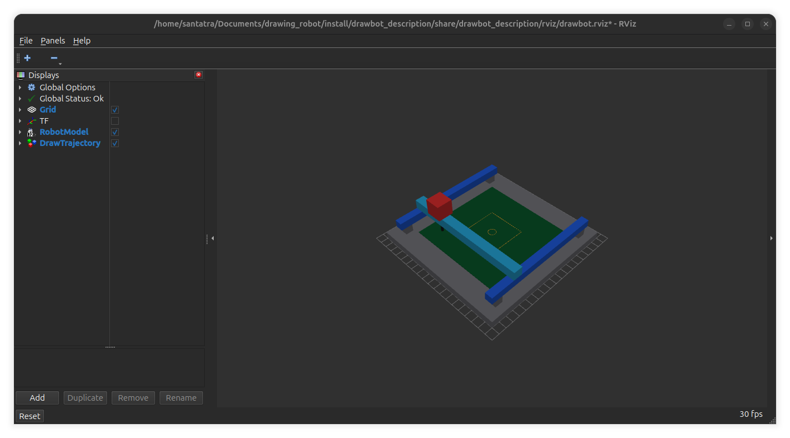

# Drawbot

Workspace ROS 2 pour simuler un robot cartésien de dessin PCB : axes $X$, $Y$ et stylo $Z$. Les commandes d’installation et d’utilisation sont détaillées dans [COMMAND.md](COMMAND.md).

## Captures d’écran

### Interface de commande XYZ

Panneau graphique pour commander les axes X/Y et le stylo Z, lancer une impression de démonstration ou annuler une trajectoire.



### Simulation dans Gazebo

Robot cartésien et plaque PCB dans le monde de simulation Gazebo Sim.



### Visualisation dans RViz

Modèle du robot et visualisation des marqueurs de trajectoire dans RViz.



## Plateforme et versions vérifiées

Pile logicielle relevée sur la machine de développement Ubuntu le 15 octobre 2026. Les versions apt peuvent recevoir des mises à jour; cette table décrit la combinaison vérifiée pour ce workspace.

| Outil / composant | Nom complet / paquet Ubuntu ou ROS | Version vérifiée |
|---|---|---:|
| Système | Ubuntu 26.04.1 LTS « Resolute Raccoon » (`resolute`) | 26.04 |
| Interpréteur | CPython (`python3.14`) | 3.14.4 |
| ROS 2 | ROS 2 Lyrical, paquet meta `ros-lyrical-desktop` | 0.13.0 |
| Simulateur | Gazebo Sim (`gz sim`, Gazebo Sim 10) | 10.5.0 |
| Intégration ROS–Gazebo, simulation | `ros-lyrical-ros-gz-sim` | 3.0.10 |
| Intégration ROS–Gazebo, bridge | `ros-lyrical-ros-gz-bridge` | 3.0.10 |
| Interfaces ROS–Gazebo | `ros-lyrical-ros-gz-interfaces` | 3.0.10 |
| Contrôle Gazebo | `ros-lyrical-gz-ros2-control` | 3.0.9 |
| Contrôle robot ROS 2 | `ros-lyrical-ros2-control` | 6.10.1 |
| Contrôleurs ROS 2 | `ros-lyrical-ros2-controllers` | 6.9.0 |
| Description Xacro | `ros-lyrical-xacro` | 2.1.1 |
| Visualisation | `ros-lyrical-rviz2` | 15.2.6 |
| Publication des états robot | `ros-lyrical-robot-state-publisher` | 3.5.6 |
| GUI joint-state pour RViz seul | `ros-lyrical-joint-state-publisher-gui` | 2.4.3 |
| Résolution des dépendances | `python3-rosdep` | 0.27.0 |
| Build ROS | `colcon-core` / `colcon-ros` | 0.21.3 / 0.5.0 |
| GUI Tk | `python3-tk` | 3.14.3 |

Les paquets `ros-lyrical-*` sont distribués par les dépôts ROS 2 pour Ubuntu Resolute. Gazebo est **Gazebo Sim 10**, lancé par `gz sim` et intégré à ROS avec `ros_gz_sim`, `ros_gz_bridge` et `gz_ros2_control` — ce projet n’utilise pas Gazebo Classic.

## Packages

| Package                                                 | Contenu                                     |
| ------------------------------------------------------- | ------------------------------------------- |
| [drawbot_description](src/drawbot_description/README.md) | Xacro/URDF, RViz et affichage autonome.     |
| [drawbot_gazebo](src/drawbot_gazebo/README.md)           | Monde SDF, Gazebo Sim et spawn du robot.    |
| [drawbot_control](src/drawbot_control/README.md)         | ros2_control, panneau XYZ et nœuds Python. |
| [drawbot_bringup](src/drawbot_bringup/README.md)         | Lancement intégré.                        |

Les ressources suivent la disposition ROS 2 conventionnelle : `launch/`, `urdf/`, `rviz/`, `worlds/`, `config/` et le module `drawbot_control/`. Les dossiers `build/`, `install/` et `log/` sont générés par colcon.

## Prérequis

- Ubuntu 26.04 LTS Resolute; ROS 2 Lyrical et Gazebo Sim 10 compatibles.
- `colcon`, `rosdep`, `xacro`, RViz, `robot_state_publisher`, `ros_gz_sim`, `ros_gz_bridge`, `ros_gz_interfaces`, `gz_ros2_control`, `ros2_control` et `ros2_controllers`.
- Python 3.14 et `python3-tk` pour la fenêtre XYZ.
- `python3-venv` et `python3-pip` si vous utilisez l’environnement virtuel optionnel décrit ci-dessous.

## Environnement virtuel Python optionnel

Le fichier [requirements.txt](requirements.txt) contient les dépendances **PyPI seulement** nécessaires au packaging Python du projet. Les modules ROS (`rclpy`, messages, launch), Gazebo et Tkinter viennent des paquets apt/ROS ci-dessus; ne tentez pas de les installer avec `pip`.

Créer un venv qui voit les modules Python livrés par ROS et Ubuntu (nécessaire notamment pour `empy`, utilisé par les interfaces ROS), puis installer les exigences Python du dépôt :

```bash
cd /home/santatra/Documents/drawing_robot
python3 -m venv --system-site-packages .venv
source /opt/ros/lyrical/setup.bash
source .venv/bin/activate
python -m pip install -r requirements.txt
```

Le venv actuellement présent dans ce workspace a été créé avec `include-system-site-packages = false`; il ne peut donc pas importer correctement toutes les dépendances Python ROS, même après avoir sourcé ROS. S’il est déjà présent, sauvegardez-le ou renommez-le avant de recréer `.venv` avec `--system-site-packages`. Ce venv reste optionnel : `colcon build` et les commandes système fonctionnent également avec l’environnement Python Ubuntu utilisé par ROS.

Si rosdep ne connaît pas la clé `ament_python` sur cette installation, ignorer cette seule clé :

```bash
export ROS_DISTRO=lyrical
source "/opt/ros/${ROS_DISTRO}/setup.bash"
rosdep install --from-paths src --ignore-src --rosdistro "${ROS_DISTRO}" --skip-keys ament_python -r -y
```

# Compiler

## Drawbot — robot cartésien de dessin

Drawbot est un workspace **ROS 2** pour modéliser, simuler et commander un robot cartésien destiné à des démonstrations de tracé sur PCB. Le portique se déplace sur les axes **X/Y** et utilise un stylo commandé sur l’axe **Z**. La simulation repose sur Gazebo Sim et `ros2_control`.

> **État du projet :** prototype de simulation. Le modèle et les commandes sont conçus pour Gazebo ; aucune interface avec un robot physique n’est fournie.

## Fonctionnalités

- Description du robot paramétrée en Xacro/URDF et affichage dans RViz.
- Monde de travail SDF avec table; PCB intégré comme lien fixe à la description du robot.
- Contrôle des axes avec `ros2_control` : trajectoires X/Y et commande du stylo Z.
- Panneau graphique pour envoyer des cibles X/Y/Z et annuler une trajectoire XY.
- Nœuds de démonstration pour un motif fixe et des marqueurs RViz.

## Architecture du workspace

| Package                 | Responsabilité                                                              | Documentation                                         |
| ----------------------- | ---------------------------------------------------------------------------- | ----------------------------------------------------- |
| `drawbot_description` | Modèle Xacro/URDF, configuration RViz et affichage autonome.                | [README du package](src/drawbot_description/README.md) |
| `drawbot_gazebo`      | Monde SDF, démarrage de Gazebo, création du robot et bridge de l’horloge. | [README du package](src/drawbot_gazebo/README.md)      |
| `drawbot_control`     | Configuration `ros2_control`, GUI XYZ et nœuds de démonstration.         | [README du package](src/drawbot_control/README.md)     |
| `drawbot_bringup`     | Lancements intégrés de la simulation et de l’affichage seul.              | [README du package](src/drawbot_bringup/README.md)     |

## Compilation

Depuis la racine du workspace :

```bash
source "/opt/ros/${ROS_DISTRO}/setup.bash"
colcon build --symlink-install --packages-up-to drawbot_bringup
source install/setup.bash
```

`--packages-up-to drawbot_bringup` compile le package de lancement et ses dépendances. Après une nouvelle compilation, sourcer de nouveau `install/setup.bash` dans chaque terminal ROS utilisé.

## Démarrage rapide

Lancer la simulation complète :

```bash
ros2 launch drawbot_bringup simulation.launch.py
```

Par défaut, ce lancement démarre Gazebo, le robot, les contrôleurs, RViz, les marqueurs de démonstration et la fenêtre **Drawbot — commande XYZ**. Le dessin automatique est désactivé par défaut pour éviter que la démonstration et la GUI commandent simultanément les mêmes contrôleurs.

Dans la GUI, régler les valeurs X/Y/Z, puis sélectionner **Envoyer XYZ**. **Centre (stylo levé)** ramène X/Y à zéro avec le stylo relevé ; **Aléatoire** choisit une cible bornée ; **Annuler XY** annule la trajectoire XY en cours.

### Arguments du lancement intégré

| Argument    | Valeur par défaut | Description                                    |
| ----------- | -----------------: | ---------------------------------------------- |
| `rviz`    |           `true` | Active ou désactive RViz.                     |
| `markers` |           `true` | Active ou désactive les marqueurs d’exemple. |
| `xyz_gui` |           `true` | Active ou désactive la commande manuelle.     |
| `draw`    |          `false` | Lance le motif automatique prédéfini.        |

Exemples :

```bash
# Simulation sans RViz ni marqueurs
ros2 launch drawbot_bringup simulation.launch.py rviz:=false markers:=false

# Démonstration automatique, sans GUI manuelle
ros2 launch drawbot_bringup simulation.launch.py draw:=true xyz_gui:=false
```

Pour démarrer uniquement l’environnement Gazebo, utiliser `ros2 launch drawbot_gazebo gazebo.launch.py`. Pour afficher le robot seul dans RViz, utiliser `ros2 launch drawbot_description display.launch.py`.

Pendant que Gazebo fonctionne, les scripts `./scripts/affichage.sh` et `./scripts/joint_states.sh` affichent respectivement l’état des contrôleurs et les mesures X/Y/Z en tableaux actualisés au même endroit dans des terminaux séparés. Voir [COMMAND.md](COMMAND.md) pour le détail.

### Tableau d’état des contrôleurs

Pendant que Gazebo tourne, afficher l’état de `joint_state_broadcaster`, `xy_controller` et `pen_controller` dans un tableau terminal coloré :

```bash
./scripts/affichage.sh
```

Le script charge ROS 2 Lyrical et le workspace, puis formate la sortie de `ros2 control list_controllers`. Vert signifie `active`; rouge ou jaune signale un état différent. Gazebo et `/controller_manager` doivent déjà être démarrés.

## Modèle et interfaces de commande

Le modèle définit trois articulations prismatiques : `joint_x`, `joint_y` et `joint_pen`. Le PCB (250 × 250 × 1 mm) est fixé au plateau supérieur du robot, tandis que la table reste un support. Les plages du modèle sont :

| Axe       | Articulation  |   Plage configurée |
| --------- | ------------- | ------------------: |
| X         | `joint_x`   |   −0,10 à +0,10 m |
| Y         | `joint_y`   |   −0,10 à +0,10 m |
| Z (stylo) | `joint_pen` | −0,0065 à +0,020 m |

La GUI limite la commande Z à −0,0065…+0,020 m. **Z = 0 relève le stylo** ; avec la pointe sphérique ajoutée à la collision URDF, le contact géométrique calculé est à environ −0,0060 m et l’impression utilise −0,00615 m pour un léger appui simulé. Vérifier le contact visuellement dans Gazebo si la géométrie change.

| Interface ROS                              | Rôle                                                                         |
| ------------------------------------------ | ----------------------------------------------------------------------------- |
| `/joint_states`                          | États des articulations publiés par `joint_state_broadcaster`.            |
| `/xy_controller/follow_joint_trajectory` | Action de trajectoire des axes X et Y.                                        |
| `/pen_controller/commands`               | Commandes de position du stylo, de type `std_msgs/Float64MultiArray`.       |
| `/draw_markers`                          | Marqueurs d’exemple de type `visualization_msgs/MarkerArray` pour RViz.    |
| `/draw_commands`                         | Exemple de commandes de dessin encodées en JSON dans un `std_msgs/String`. |

## Démonstrations et limites connues

- `draw_node` exécute un motif PCB fixe via les contrôleurs. Il partage ces contrôleurs avec la GUI : utiliser l’un ou l’autre, pas les deux en même temps.
- `pcb_generator` publie des exemples JSON sur `/draw_commands`, mais aucun nœud ne convertit actuellement ces messages en trajectoires ; ce générateur ne déclenche donc pas le dessin.
- Le nœud d’exemple publie des marqueurs dans RViz; séparément, la GUI ajoute des segments orange persistants dans Gazebo en temps réel lorsque la pointe mesurée touche et parcourt la plaque verte. Il s’agit d’une visualisation sans collision, pas d’un dépôt d’encre physique.
- Le contact du stylo et le comportement mécanique restent à valider dans la simulation. Ce dépôt ne fournit pas de pilote ou de configuration de sécurité pour du matériel réel.
- Les tests automatisés ne couvrent pas encore les trajectoires complètes ni l’intégration Gazebo/contrôleurs.

## Tests

Les tests déclarés dans le package de contrôle peuvent être lancés ainsi :

```bash
colcon test --packages-select drawbot_control
colcon test-result --verbose
```

## Licence

Les packages déclarent la licence **Apache-2.0**. Voir les fichiers `package.xml` de chaque package pour les métadonnées associées.
